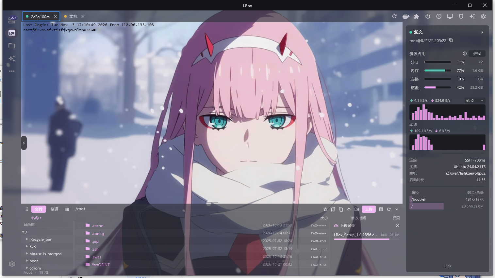

<div align="center">

English | [简体中文](README_zh.md)

# LBox

A desktop SSH / server management tool built with Flutter and Rust.
Windows first, forked from [ServerBox](https://github.com/lollipopkit/flutter_server_box).

</div>

## Screenshots



> Add or replace images in `screenshots/`.

## Features

- **SSH terminal** with multiple session tabs and per-session controls.
- **Status panel** down the right of a session: CPU (× cores), memory, swap,
  network sparklines, uptime and the per-mount disk list. Addresses are masked
  by default (`root@8.***.**.205:22`), with a one-click copy of the real one.
- **File manager** docked under the terminal: browse, rename, delete, create
  folders, and upload with a **live progress + history pane** whose width you
  can drag. Uploads use a dedicated channel, so browsing stays responsive.
- **One colour scheme for the whole page**: accent and text colours, panel
  colour and transparency, and terminal background/foreground — with an RGB
  picker that previews the terminal live while you drag.
- **Top-bar actions**: reconnect, containers, services, power, scheduled tasks,
  remote desktop, firewall, ask AI, settings.

## Download / install (Windows)

- **Installer**: `LBox_Setup_<version>.exe` — choose the install directory,
  creates a desktop shortcut, registers an uninstaller, and bundles the
  VC++ runtime.
- **Portable**: unzip `LBox_<build>_windows_amd64.zip` and run `LBox.exe`.

## Build from source

Requirements: Flutter, Rust, and the Visual Studio C++ build tools on Windows.

```powershell
flutter pub get
dart run fl_build -p windows
# output: build/windows/x64/runner/Release/
```

Packaging the installer uses the included [Inno Setup](https://jrsoftware.org/isinfo.php)
script [LBox.iss](LBox.iss):

```powershell
iscc LBox.iss
```

> The `.iss` script points at a local VC++ redistributable path; adjust it (or
> vendor the DLLs) before building on another machine.

## License & attribution

LBox is a modified fork of **ServerBox** by lollipopkit
(<https://github.com/lollipopkit/flutter_server_box>), licensed under the
**GNU Affero General Public License v3.0**. The full license text is in
[LICENSE](LICENSE); what was changed is summarised in [NOTICE](NOTICE).

As required by the AGPL-3.0, the complete source of this modified version is
published in this repository, and any binary built from it is distributed with
access to this source.

Thanks also to [dartssh2](https://github.com/TerminalStudio/dartssh2) and
[xterm.dart](https://github.com/TerminalStudio/xterm.dart).

LBox is not affiliated with or endorsed by the upstream author.
