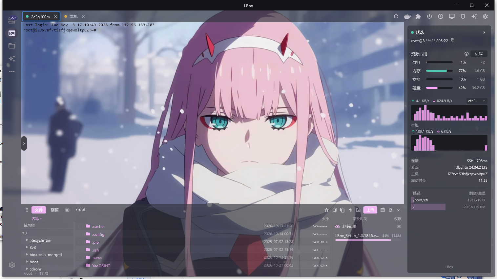

<div align="center">

[English](README.md) | 简体中文

# LBox

基于 Flutter + Rust 的桌面 SSH / 服务器管理工具，优先支持 Windows。
由 [ServerBox](https://github.com/lollipopkit/flutter_server_box) 修改而来。

</div>

## 截图



> 图片放在 `screenshots/`，可自行增删替换。

## 功能

- **SSH 终端**：多会话标签、按会话操作。
- **右侧状态面板**：CPU（× 核心数）、内存、Swap、网络曲线、运行时长，以及按挂载点分别列出的磁盘。地址默认打码显示（如 `root@8.***.**.205:22`），旁边的小按钮可一键复制真实地址。
- **文件管理器**（停靠在终端下方）：浏览、重命名、删除、新建文件夹；上传时右侧会分出一个**上传进度与历史小窗**，宽度可左右拖动。上传走独立通道，浏览文件不卡。
- **整页统一配色**：强调色、文字色、面板色与透明度、终端背景/前景色，全部用 RGB 滑块调节，拖动时终端实时预览。
- **顶栏功能**：重连、容器、服务、电源、计划任务、远程桌面、防火墙、询问 AI、设置。

## 下载 / 安装（Windows）

- **安装版**：`LBox_Setup_<版本>.exe` —— 可选择安装目录、自动创建桌面快捷方式、注册卸载程序，并内置 VC++ 运行库。
- **便携版**：解压 `LBox_<build>_windows_amd64.zip`，直接运行 `LBox.exe`。

## 从源码构建

需要：Flutter、Rust、Visual Studio C++ 生成工具（Windows）。

```powershell
flutter pub get
dart run fl_build -p windows
# 产物：build/windows/x64/runner/Release/
```

打包安装程序使用仓库内的 [Inno Setup](https://jrsoftware.org/isinfo.php) 脚本 [LBox.iss](LBox.iss)：

```powershell
iscc LBox.iss
```

> `LBox.iss` 里引用了本机 VC++ 运行库路径，换机器打包前请改成自己的路径（或把 DLL 一并放进仓库）。

## 许可证与署名

LBox 是基于 lollipopkit 的 **ServerBox**
（<https://github.com/lollipopkit/flutter_server_box>）修改的分支，
采用 **GNU Affero 通用公共许可证 v3.0（AGPL-3.0）**。完整许可证见
[LICENSE](LICENSE)，修改说明见 [NOTICE](NOTICE)。

按 AGPL-3.0 要求，本修改版的完整源码公开在本仓库，基于它构建的二进制也会在提供时给出源码获取方式。

同时感谢 [dartssh2](https://github.com/TerminalStudio/dartssh2) 与
[xterm.dart](https://github.com/TerminalStudio/xterm.dart)。

LBox 与上游作者无关联，也未获其背书。
